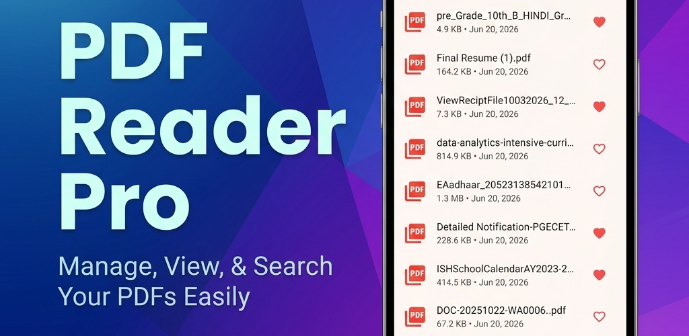

# PDF Reader Pro: Merge & Split 📄✨

A modern, lightweight, and completely offline PDF reader and document utility built with Flutter.



## 🌟 Overview

**PDF Reader Pro** is a fast, privacy-focused PDF management tool designed for Android and cross-platform devices. It packs essential productivity utilities into a single app without requiring cloud servers, subscriptions, or intrusive permissions. All document processing—including viewing, page extraction, splitting, and merging—takes place 100% locally on your device.

---

## 🚀 Key Features

- **⚡ Fast Offline PDF Viewer**: Smooth page scrolling, zoom, thumbnail preview, and rapid rendering powered by `pdfrx`.
- **📑 Merge PDFs**: Combine multiple PDF files into a single unified document with intuitive page-selection and custom file naming.
- **✂️ Split & Extract Pages**: Choose specific pages from any document and extract them into an independent new PDF.
- **🏷️ Bookmarks & Tags**: Organize your library with custom colored tags and quick bookmarks.
- **📊 Reading Statistics & History**: Automatically tracks recent reads, reading duration, and page completion metrics.
- **🌗 Adaptive Dark & Light Modes**: Seamless dark and light theme transitions with custom-tailored contrast for comfortable reading.
- **🔒 Privacy First**: Zero tracking, zero telemetry, and zero document uploads. Your files never leave your device.
- **📂 System File Integration**: Automatically registered to handle "Open With" PDF intents across the system.

---

## 🛠️ Tech Stack & Libraries

- **Framework**: [Flutter](https://flutter.dev/) (Dart 3+)
- **PDF Engine**: [pdfrx](https://pub.dev/packages/pdfrx) & [pdf](https://pub.dev/packages/pdf)
- **Local Database**: [sqflite](https://pub.dev/packages/sqflite)
- **State Management**: [provider](https://pub.dev/packages/provider)
- **File & Storage Utilities**: [path_provider](https://pub.dev/packages/path_provider), [share_plus](https://pub.dev/packages/share_plus)
- **Native Android Integration**: Custom Intent filter in `MainActivity.kt` for seamless document viewing.

---

## 📂 Project Structure

```
lib/
├── database/            # SQLite database helper for tracking docs, history & tags
├── models/              # Data models (PdfDocument, TagModel, etc.)
├── providers/           # State management (PdfProvider, SettingsProvider, TagProvider)
├── screens/             # UI screens
│   ├── home_screen.dart
│   ├── library_tab.dart
│   ├── pdf_page_selection_screen.dart
│   ├── pdf_tools_tab.dart
│   ├── pdf_viewer_screen.dart
│   ├── splash_screen.dart
│   └── statistics_tab.dart
├── utils/               # Helpers (Thumbnail generation, file utilities)
└── widgets/             # Reusable UI components & widgets
```

---

## 💻 Getting Started

### Prerequisites

- Flutter SDK (v3.22.0 or higher recommended)
- Android Studio / VS Code with Flutter extension
- Android SDK (API 34+)

### Installation

1. **Clone the repository**:
   ```bash
   git clone https://github.com/riyaz-pattan/PDF-Reader.git
   cd PDF-Reader
   ```

2. **Install dependencies**:
   ```bash
   flutter pub get
   ```

3. **Run the app**:
   ```bash
   flutter run
   ```

### Building for Release

To generate an Android App Bundle (AAB):
```bash
flutter build appbundle --release
```

To generate an APK:
```bash
flutter build apk --release
```

---

## 📄 License

This project is licensed under the [MIT License](LICENSE).
